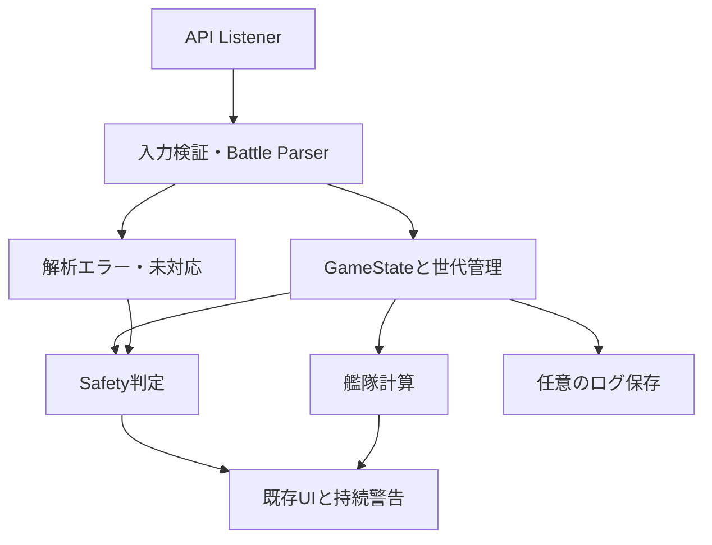

# Architecture 初版

現行と提案を分ける。この文書は実装済みGameStateを説明するものではない。

## 現行

`assets/js/inject.js`のXHR観測 → WebController._kancolleMessageHandle → rawDataProvider → Home.enableListener → KancolleData.parseWith/parse → DataModelAdapter → Fleet/Squad/BattleInfo/MapState → Riverpod経由のDashboard/Alert/Toast。

KancolleDataはRef・ObjectBox・通知・Crashlyticsにも依存し、入力解釈、可変状態更新、ログ、副作用がまとまっている。Shipは@unfreezedの可変モデル。Fleet.shipsとSquad.shipsは最初は参照共有するが、copyWithApi後は別オブジェクトになり得る。BattleInfoはHP初期化→フェーズのdamage map→updateShipHPという処理を持つ。

## 最小の目標構成

GameStateはまず既存KancolleDataを包む境界として導入する。多数のRepository・DBを先に作らない。

| 状態 | 最小データ | 責務 |
|---|---|---|
| Ships | instance ID→ShipSnapshot | master ID/艦種/Lv/HP/MaxHP/cond/fuel/ammo/装備instance IDs/増設/搭載数、フィールド別鮮度 |
| Equipment | instance ID→装備 | master ID/改修/熟練度。既存Fleet.equipmentを活用 |
| Fleets | 艦隊ID→Ship IDs | 順序・出撃・遠征。Shipオブジェクトを別保存しない |
| Sortie | 出撃ID/海域/マス/戦闘世代 | 主力/随伴、退避候補と確定退避、HP判定の有効性 |
| Master | 艦/装備/海域master | 最大燃料/弾薬等。master不足を欠損として返す |

ShipSnapshotは最初から全状態を永続DBにしない。内部世代番号、source API、受信時刻、出撃IDを付ける。HPが新しくてもfuelやcondが最新とは限らないため、全体に「最新」1フラグを置く方式では不足。

Battle Parserは入力snapshotから結果を返す純粋な層にする。結果は`Success(finalHpByShipId, escapedIds, provenance)`または`Failure(reason, affectedIds)`。途中で実状態を変更せず、配列長・位置・型・フェーズを検証した後、一括で反映する。例外・未対応はFailure、未知のdamage-bearingフェーズを無視してSuccessにしない。

味方はinstance IDを使う。敵/友軍に味方のuid=-1を流用せず、戦闘局所キー（side/fleet/position）を使う。UIはsnapshotと計算結果を購読し、Toastの寿命からSafety状態を逆算しない。

## 移行順

1. 調査・環境・各艦condの小変更を先に完了する。
2. 既存入出力のfixtureを作り、ログON/OFFに依存しない解析経路を確立する。
3. SAFE/DANGER/UNKNOWNを導入し、古いHPを判定に使わない。純粋Safety関数は先に導入可能。
4. port/ship_deck/編成/補給をShip ID中心に順に移す。旧UIには互換adapterを置く。
5. Battle Parserを純粋化してatomic更新へ移し、形式別にテストを増やす。

最後に新旧状態を二重更新する期間を終える。一度に全UIを作り直さず、各PRで移したAPIと残るAPIを明記する。
